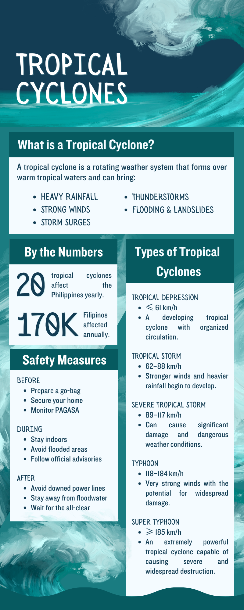

# 🦋 Activity 03: Social Media Infographics & Mini Project Documentation

୨୧ ──────────────── ✧ ──────────────── ୨୧

 

## 🕊️ About the Activity

This activity explores the use of digital tools and visual communication in creating informative and engaging content. It involves developing a social media infographic and preparing documentation for a technology-based mini project, highlighting how digital platforms can be used to communicate ideas and present information effectively.

 

## 🎨 Activity Outputs

### 1. Social Media Infographic

The social media infographic presents information through a combination of visual elements and concise text. It applies visual communication principles to make the content organized, understandable, and engaging for its intended audience.

Social Media Infographic

 

### 2. Mini Project Documentation

The mini project documentation presents a technology-based project proposal through organized written content. It demonstrates the application of digital tools in developing and documenting a project idea.

 

## ✧ Skills and Concepts Applied

- **Visual Communication** – Presenting information through an effective combination of text and visual elements.
- **Digital Design** – Using digital tools to create organized and visually engaging materials.
- **Information Organization** – Arranging content logically to improve clarity and understanding.
- **Digital Documentation** – Preparing structured documentation to communicate a project proposal.
- **Creativity and Innovation** – Exploring ways technology can support the development and presentation of ideas.

 

## 🪷 What Have I Learned?

Through this activity, I learned how digital tools can support both visual communication and project development. I gained a better understanding of how to combine concise text and visual elements to create an informative infographic, as well as how to organize ideas into structured project documentation.

One challenge was deciding how to present information without making the infographic overcrowded or difficult to understand. I addressed this by focusing on the organization of content and the use of visual elements to support the message. I can apply these skills in future digital projects by creating clearer visual materials, organizing information effectively, and improving the way I communicate ideas through technology.

 

## 🪷 Reflection

This activity provided an opportunity to explore how digital tools can be used for both visual communication and project development. Creating a social media infographic emphasized the importance of presenting information clearly and creatively, while preparing the mini project documentation strengthened my understanding of organizing and communicating a technology-based project idea.

Through this activity, I gained further appreciation for the role of digital technology in creating meaningful content and presenting ideas effectively.
